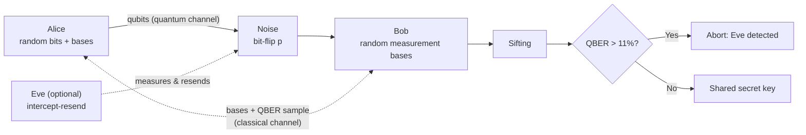
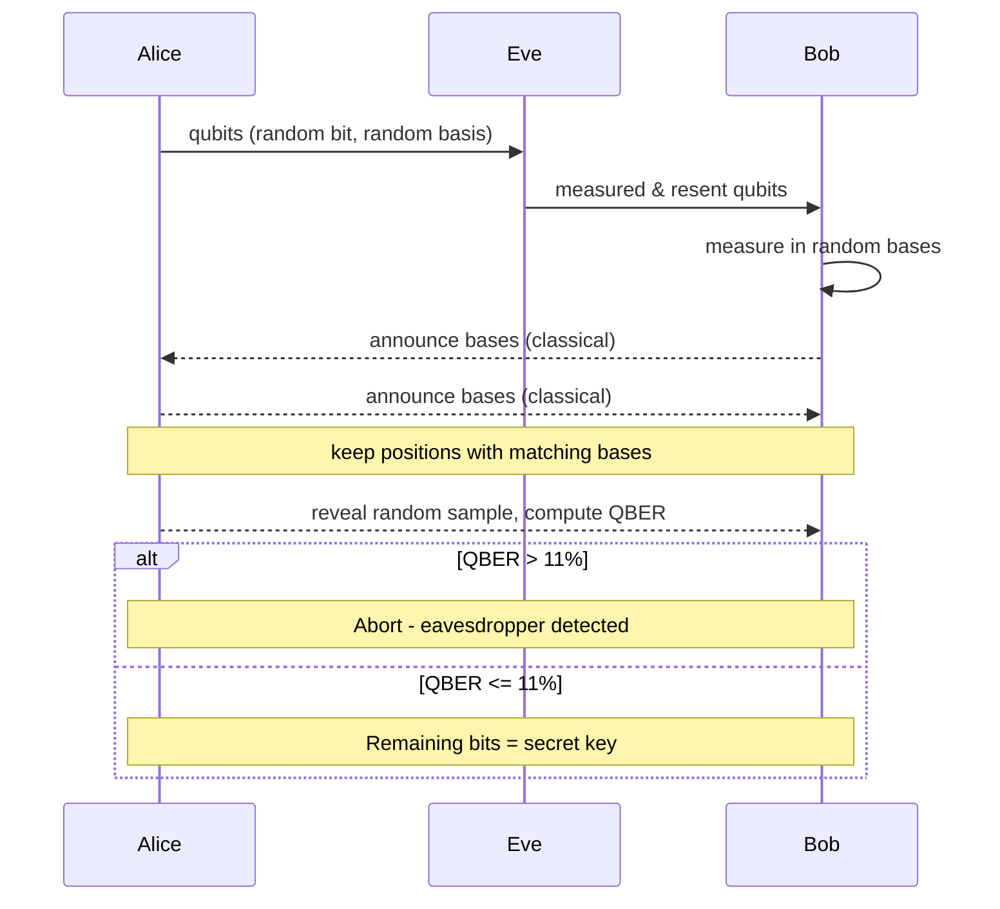

<h1 align="center">BB84 Quantum Key Distribution Simulator</h1>

<p align="center">
  
  
  
  
  <a href="../../actions"></a>
</p>

<p align="center">
A Python simulation of the <b>BB84 protocol</b> (Bennett &amp; Brassard, 1984) that models an
<b>intercept-resend eavesdropper</b>, channel noise, key sifting and <b>QBER-based attack detection</b>.
</p>

---

## Highlights
- Faithful BB84 flow: random bits/bases, sifting, public QBER sample, abort threshold
- Eavesdropper model with adjustable interception probability
- Channel-noise model (bit-flip probability)
- Reproducible runs via seeds; vectorised with NumPy (100k+ qubits in milliseconds)
- CLI, importable library, unit tests, CI, and generated analysis plots

## System Block Diagram


## Protocol Pipeline


### Interactive version (rendered by GitHub)




## Why Eve gets caught
When Eve guesses the wrong basis (50% of the time) she randomises the qubit, so Bob (when his basis matches Alice's) sees an error half the time. Result: **QBER = 25% x (fraction intercepted)**.


## Installation
```bash
git clone https://github.com/<your-username>/bb84-qkd-simulator.git
cd bb84-qkd-simulator
pip install -e ".[dev]"
```

## Usage
```bash
bb84-sim -n 2000                      # clean channel -> QBER 0%, secure key
bb84-sim -n 2000 --eve 1.0            # full interception -> ~25% QBER, detected
bb84-sim -n 2000 --eve 0.3 --noise 0.02 --seed 42
python examples/qber_vs_eve.py        # regenerate the plot
python docs/make_diagrams.py          # regenerate the block diagrams
```

**Sample output**
```
Qubits sent      : 2000
Sifted key length: 982
Sample compared  : 245
QBER             : 24.90%
Result           : EAVESDROPPER DETECTED - key discarded
```

**Library**
```python
from bb84 import run_bb84
r = run_bb84(n_qubits=5000, eve_prob=0.5, noise=0.01, seed=1)
print(r.qber, r.eve_detected, r.key_length)
```

## Parameters
| Parameter | Description | Default |
|---|---|---|
| `n_qubits` | Qubits Alice sends | 1000 |
| `eve_prob` | Fraction of qubits Eve intercepts | 0.0 |
| `noise` | Channel bit-flip probability | 0.0 |
| `sample_fraction` | Share of sifted key used to estimate QBER | 0.25 |
| `threshold` | Abort if QBER exceeds this | 0.11 |
| `seed` | RNG seed | None |

## Project Structure
```
bb84-qkd-simulator/
├── bb84/                 # core package (simulator + CLI)
├── tests/                # pytest suite
├── examples/             # QBER-vs-Eve analysis
├── docs/                 # block diagrams + generator script
├── .github/workflows/    # CI
├── pyproject.toml
└── README.md
```

## Testing
```bash
pytest -v
```

## Limitations and Roadmap
- [x] Intercept-resend attack, noise, sifting, QBER detection
- [ ] Error correction (Cascade) and privacy amplification
- [ ] Photon-loss and multi-photon (PNS attack) models
- [ ] Decoy-state BB84
- [ ] Streamlit web interface

## References
- C. H. Bennett and G. Brassard, "Quantum cryptography: Public key distribution and coin tossing", 1984
- Gisin et al., "Quantum cryptography", Rev. Mod. Phys. 74, 145 (2002)

## License
MIT. See [LICENSE](LICENSE). Contributions welcome: see [CONTRIBUTING.md](CONTRIBUTING.md).
